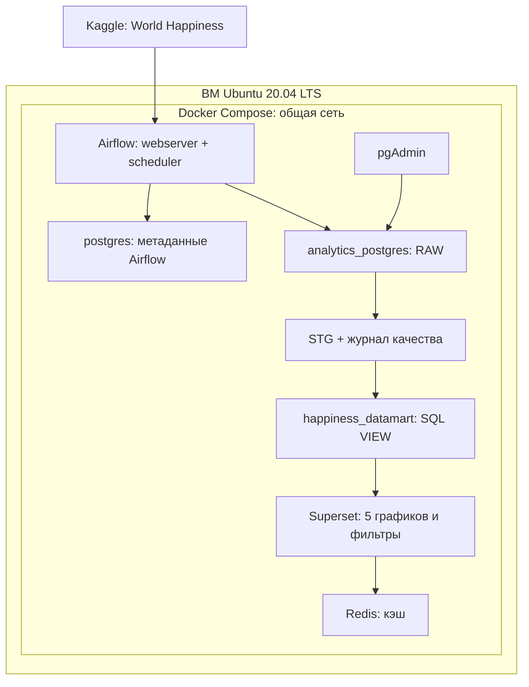
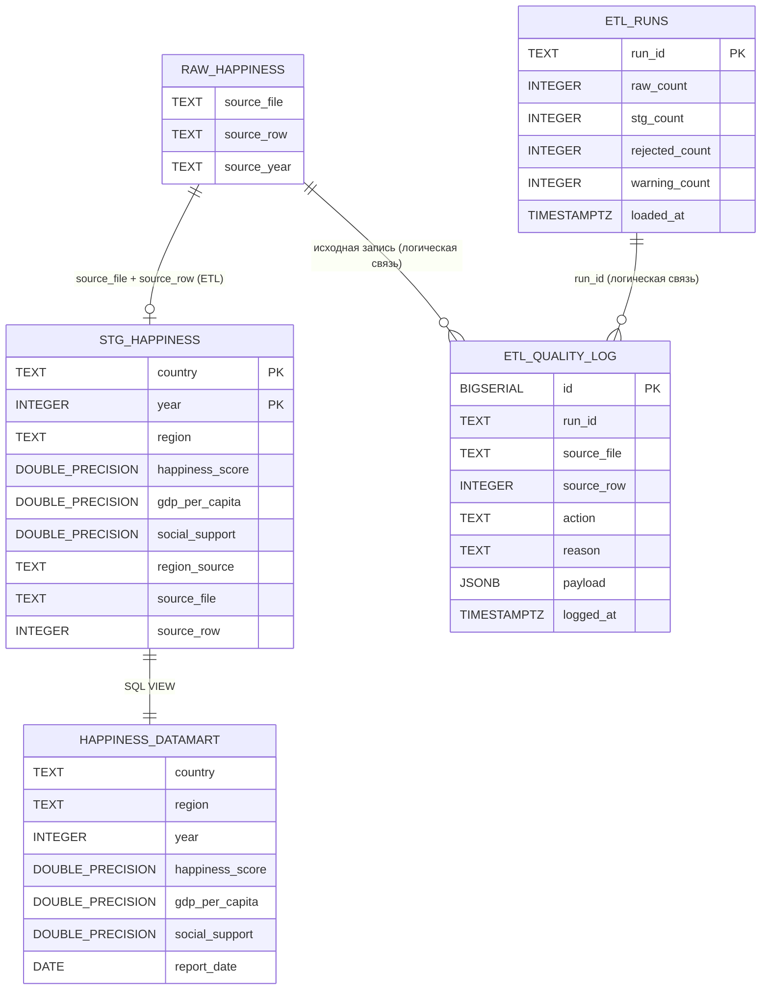

# Лабораторная работа № 3. Анализ счастья в мире

**Вариант 9. Автор: Войт Иван Иванович.**

Источник: [World Happiness Report, Kaggle / unsdsn](https://www.kaggle.com/datasets/unsdsn/world-happiness).
Основа окружения: [шаблон преподавателя](https://github.com/BosenkoTM/DCCAS/tree/main/lpw_04).
Каталог решения назван `lpw_03`, как требуется в задании. `lpw_04` - адрес опубликованного образца.

**Статус выполнения:** проект собран и запущен в VirtualBox на Ubuntu 20.04.6 LTS. Все пять задач DAG завершились со статусом `success`. Данные получены из Kaggle через `kagglehub`, 782 строки загружены в RAW/STG/VIEW без потерь. Проверены пять графиков Superset и фильтры по году и региону. Штатный экспорт и подтверждения включены в проект.

## 1. Цель работы

Выявить различия в субъективном благополучии между странами и регионами и оценить его динамику за 2015–2019 годы. Результат предназначен для аналитической группы, выбирающей страны для сравнительного исследования социальной политики: определить лидеров, регионы с более низкими оценками и направления дальнейшего анализа факторов благополучия.

Бизнес-вопросы: какие страны лидируют по баллу счастья, как различаются регионы, меняется ли средняя оценка по годам и насколько региональные различия в оценке согласуются с вкладом экономического фактора. Данные описывают наблюдаемые различия и не доказывают причинное влияние ВВП или социальной политики.

## 2. Исследуемые метрики бизнес-процесса

Единица наблюдения - **страна в конкретном году отчёта**. Год получен из имени файла. Это год публикации отчёта, а не точная дата опроса. Названия территорий в источнике сохраняют аналитическое значение «страна или территория».

| Метрика | Правило расчёта | Исходные поля | Управленческий вопрос |
|---|---|---|---|
| Средний балл счастья | `AVG(happiness_score)` по отфильтрованным наблюдениям, шкала 0–10 | `Happiness Score`, `Happiness.Score`, `Score` | Каков средний уровень благополучия в выбранной группе? |
| Топ-10 стран | `AVG(happiness_score)` по `country`, сортировка по убыванию, 10 строк | Название страны и балл счастья | Какие страны выбрать как ориентиры? |
| Распределение стран по регионам | `COUNT(DISTINCT country)` по `region`; доля от общего числа уникальных стран | `Country`, `Country or region`, `Region` | Как представлен каждый регион в анализе? |
| Средний вклад ВВП | `AVG(gdp_per_capita)` по `region`, единица - баллы вклада | `Economy (GDP per Capita)`, `Economy..GDP.per.Capita.`, `GDP per capita` | Согласуются ли экономическая компонента и общая оценка на уровне регионов? |
| Балл счастья по регионам | `AVG(happiness_score)` по `region`, шкала 0–10 | Балл счастья и регион | Какие регионы требуют дополнительного исследования? |
| Динамика среднего балла | `AVG(happiness_score)` по `year`, годы в хронологическом порядке | Балл счастья, год из имени CSV | Меняется ли оценка во времени? |
| Социальная поддержка | `social_support` сохраняется в витрине; при отдельном исследовании - `AVG(social_support)` | `Family` за 2015–2017, `Social support` за 2018–2019 | Какие дополнительные факторы исследовать в следующем шаге? |

Без фильтра года индикатор усредняет все 782 наблюдения «страна–год». Страны с пятью отчётами получают больший вес, чем страны с одним отчётом. Это не среднее по населению Земли и не среднее сначала по странам. Топ-10 без фильтра года - рейтинг по среднему за доступные годы. При выборе одного года получается рейтинг этого года.

**Смысл `gdp_per_capita`:** в этих CSV это вклад экономического фактора в объяснение балла счастья, а не ВВП на душу населения в долларах. Поле сохраняет имя из варианта, а подпись графика отражает единицы. `social_support` также представляет компоненту оценки; значения `Family` и `Social support` объединены как тематически соответствующие компоненты с ограничением межгодовой сопоставимости.

### 2.1. Сопоставление полей разных лет

| Поле витрины | 2015–2016 | 2017 | 2018–2019 |
|---|---|---|---|
| `country` | `Country` | `Country` | `Country or region` |
| `region` | `Region` | Справочник из 2015–2016 | Справочник из 2015–2016 |
| `year` | Имя CSV | Имя CSV | Имя CSV |
| `happiness_score` | `Happiness Score` | `Happiness.Score` | `Score` |
| `gdp_per_capita` | `Economy (GDP per Capita)` | `Economy..GDP.per.Capita.` | `GDP per capita` |
| `social_support` | `Family` | `Family` | `Social support` |

Регионы для поздних файлов восстанавливаются по нормализованному названию страны из того же набора данных. При наличии нескольких справочных записей используется последняя доступная классификация (2016, затем 2015). В предоставленной выборке регион одной страны не меняется между годами.

| Название источника | Единое название в STG |
|---|---|
| Taiwan Province of China | Taiwan |
| Hong Kong S.A.R., China | Hong Kong |
| Northern Cyprus | North Cyprus |
| North Macedonia | Macedonia |
| Trinidad & Tobago | Trinidad and Tobago |

Лишние и повторные пробелы в категориях убираются. Гамбия присутствует только в 2019 году и не имеет региона в справочнике источника. Её строка сохраняется с `region = 'Unknown'`, а событие `region_not_available` записывается в журнал. Географическая классификация не придумывается и внешний источник не добавляется.

### 2.2. Качество данных и потери записей

RAW хранит **все исходные колонки** как `TEXT` без очистки значений. Для разных CSV используется объединение названий колонок; несуществующая в конкретном файле колонка имеет SQL `NULL`. Пустая строка существующего поля остаётся пустой строкой в RAW. Копии исходных CSV и SHA-256 сохраняются в рабочей папке конвейера.

В STG числа преобразуются в `DOUBLE PRECISION`, год и номер записи - в `INTEGER`. Пустые необязательные числовые значения сохраняются как `NULL`, нули остаются нулями. Некорректное число, отрицательная компонента, отсутствующий или выходящий за 0–10 балл счастья, пустая страна и повтор «страна–год» отклоняются с записью причины и исходной строки в `etl_quality_log`. Первая корректная строка пары сохраняется.

| Год | Записей в CSV | Строк в STG | Отклонено | Средний балл счастья |
|---|---:|---:|---:|---:|
| 2015 | 158 | 158 | 0 | 5.375734 |
| 2016 | 157 | 157 | 0 | 5.382185 |
| 2017 | 155 | 155 | 0 | 5.354019 |
| 2018 | 156 | 156 | 0 | 5.375917 |
| 2019 | 156 | 156 | 0 | 5.407096 |
| Всего | 782 | 782 | 0 | 5.379018 |

## 3. Архитектура решения

Целевая среда - **виртуальная машина Ubuntu 20.04 LTS**, все компоненты внутри Docker. Рекомендуемые ресурсы: 4 vCPU, 8 ГБ RAM, 40 ГБ свободного диска. Фактический запуск выполнен внутри ВМ VirtualBox 7.2.2: 4 vCPU, 8192 МБ RAM, динамический VDI 40 ГБ. Windows использовалась как хост.

| Контейнер | Роль | Порт на ВМ |
|---|---|---:|
| `postgres` | PostgreSQL с метаданными Airflow | 5432 |
| `analytics_postgres` | Отдельная PostgreSQL: RAW, STG, журнал, VIEW | 5433 |
| `webserver` | Интерфейс Airflow | 8080 |
| `scheduler` | Планирование и исполнение задач через LocalExecutor | - |
| `superset` | Метаданные Superset в собственном томе, подключение к аналитической БД | 8088 |
| `redis` | Кэш Superset | 6379 |
| `pgadmin` | Просмотр и SQL-проверка аналитической БД | 5050 |
| `init` | Однократная инициализация Airflow и подключения | - |
| `dashboard-init` | После появления витрины создаёт графики и дашборд через API Superset | - |

## 4. Технологический стек

| Компонент | Версия в проекте |
|---|---|
| Целевая ОС | Ubuntu 20.04 LTS, 64 bit |
| Docker / Compose | Docker Engine 26.1.3 и Compose v2.29.7 (фактический запуск) |
| Apache Airflow / Python | 2.5.0 / 3.8 |
| PostgreSQL | 12, официальный образ `postgres:12-alpine` |
| Apache Superset | 3.1.1 |
| Redis | 7, образ `redis:7-alpine` |
| pgAdmin | 4, образ `dpage/pgadmin4:8.14` |
| pandas / NumPy | 1.5.2 / 1.22.4 |
| SQLAlchemy | 1.4.44 |
| postgres provider Airflow | 5.3.1 |
| psycopg2-binary | 2.9.9 |
| Kaggle / kagglehub | 1.5.16 / 0.2.9 |

Основные версии Python-пакетов сверены с [официальными constraints Airflow 2.5.0 для Python 3.8](https://raw.githubusercontent.com/apache/airflow/constraints-2.5.0/constraints-3.8.txt). `kagglehub` добавлен для получения данных, как требует задание. Чтение и нормализация CSV реализованы стандартной библиотекой Python; pandas доступен в образе для исследования данных.

Из шаблона сохранены состав сервисов, порты и базовые версии Airflow/Superset. Исправлены несовместимые с Python 3.8 pandas 2.3.3 и с Airflow 2.5 SQLAlchemy 2.x. Зависимости устанавливаются при сборке образа, не при каждом старте контейнера. Добавлены проверки готовности БД и ожидание инициализации Airflow. Штатный ZIP-экспорт Superset 3.1.1 сохраняется вместе с JSON-снимком объектов через API.

## 5. ER-диаграмма базы данных

В RAW дополнительно находятся все 30 исходных колонок ниже, **каждая имеет тип TEXT**. Они показаны отдельно для читаемости диаграммы; это реальные колонки таблицы, а не один JSON-столбец.

| № | Исходная колонка RAW | № | Исходная колонка RAW |
|---:|---|---:|---|
| 1 | Country | 16 | Happiness.Score |
| 2 | Region | 17 | Whisker.high |
| 3 | Happiness Rank | 18 | Whisker.low |
| 4 | Happiness Score | 19 | Economy..GDP.per.Capita. |
| 5 | Standard Error | 20 | Health..Life.Expectancy. |
| 6 | Economy (GDP per Capita) | 21 | Trust..Government.Corruption. |
| 7 | Family | 22 | Dystopia.Residual |
| 8 | Health (Life Expectancy) | 23 | Overall rank |
| 9 | Freedom | 24 | Country or region |
| 10 | Trust (Government Corruption) | 25 | Score |
| 11 | Generosity | 26 | GDP per capita |
| 12 | Dystopia Residual | 27 | Social support |
| 13 | Lower Confidence Interval | 28 | Healthy life expectancy |
| 14 | Upper Confidence Interval | 29 | Freedom to make life choices |
| 15 | Happiness.Rank | 30 | Perceptions of corruption |

Связи RAW/STG и журналов являются отношениями происхождения данных, а не физическими FK. Это позволяет независимо перезагружать слои и сохранять аудит прежних запусков. Единственный бизнес-ключ STG - `(country, year)`. `report_date = make_date(year,1,1)` - техническая дата для годового линейного графика Superset, не дата проведения опроса.

## 6. Ссылки на исходный код

| Назначение | Файл |
|---|---|
| DAG Airflow | [happiness_dag.py](dags/happiness_dag.py) |
| Извлечение, загрузка и очистка | [happiness_etl.py](dags/happiness_etl.py) |
| Структура STG и журналов | [schema.sql](dags/schema.sql) |
| Создание SQL VIEW | [datamart_variant_09.sql](dags/datamart_variant_09.sql) |
| Окружение | [docker-compose.yml](docker-compose.yml), [Dockerfile](Dockerfile), [requirements.txt](requirements.txt) |

Экспорт получен от реально запущенного Superset:

- [dashboard_export.json](superset/dashboard_export.json) - JSON-снимок объектов дашборда, чартов и Dataset через API.
- [dashboard_export.zip](superset/dashboard_export.zip) - штатный импортируемый экспорт Superset 3.1.1.

JSON-снимок не загружается в диалог импорта ZIP. Для переноса используется ZIP или повторный запуск скрипта. Dataset создан на `public.happiness_datamart`, то есть на SQL VIEW.

## 7. Выводы по анализу

Ниже - выводы по данным, полученным из Kaggle и проверенным через витрину и дашборд.

**1. Изменение среднего балла невелико и зависит от состава выборки.** В 2015 году средняя оценка равна 5.375734, в 2019 - 5.407096: рост на **0.031362 балла**. В файлах разный набор стран, поэтому изменение общей средней включает эффект состава. Действие: перед выводом об улучшении благополучия сравнить одинаковые страны. Контрольная панель из 146 стран, присутствующих во всех пяти файлах, даёт 5.417733 в 2015 и 5.496568 в 2019, рост **0.078836 балла**. Это дополнительная проверка, а не замена обязательной линии по всем наблюдениям.

**2. Рейтинг зависит от выбранного периода.** По среднему за пять доступных лет лидируют Дания (**7.546**), Норвегия (**7.541**) и Финляндия (**7.538**). В 2019 году первая Финляндия (**7.769**), затем Дания (**7.600**) и Норвегия (**7.554**). Средний рейтинг сглаживает межгодовые различия. Действие: использовать среднее за период для выбора устойчивых ориентиров, а для анализа текущего отчёта явно задавать год фильтром.

**3. Региональные средние существенно различаются, а объём данных неодинаков.** В 2019 году Australia and New Zealand - **7.2675** при двух странах; Sub-Saharan Africa - **4.294513** при 39 странах. Различие составляет около **2.973 балла**, но малый состав первого региона ограничивает обобщение. Действие: приоритизировать исследование стран с низкими оценками, а средние регионов всегда интерпретировать вместе с количеством стран на круговой диаграмме. Доля региона на круговой диаграмме - покрытие выборки, не доля населения.

**4. Одной экономической компоненты недостаточно для описания различий.** В 2019 году Middle East and Northern Africa имеет больший средний вклад ВВП (**1.059053**), чем Latin America and Caribbean (**0.924286**), но меньший средний балл счастья (**5.237** против **5.954429**). Это описательное сравнение согласуется с наличием других компонент оценки; причинность не установлена. Действие: дополнить следующий этап исследования социальной поддержкой и другими факторами, а не ранжировать благополучие только по экономической компоненте.

